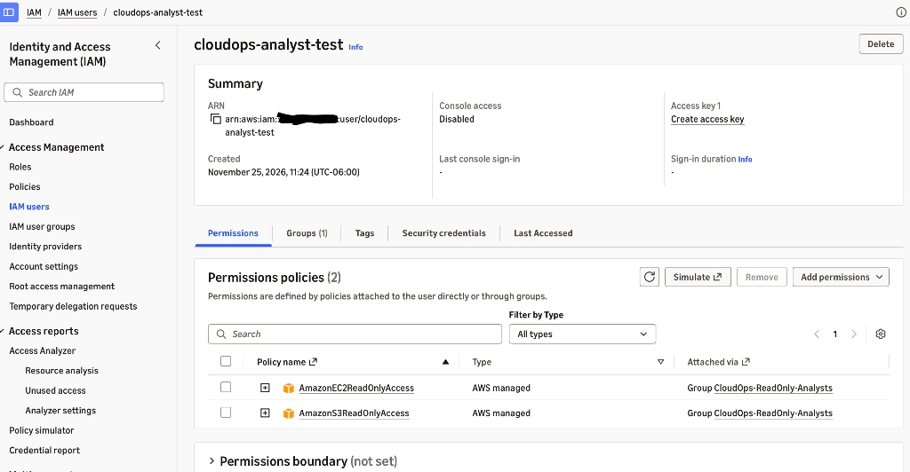
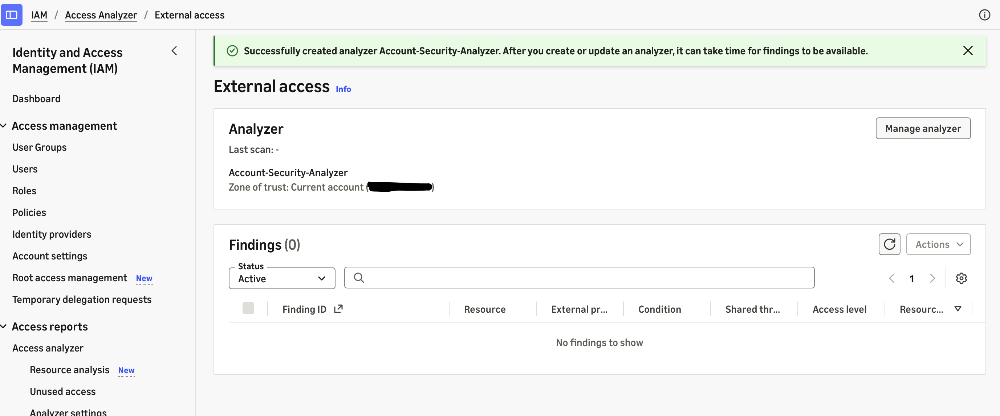
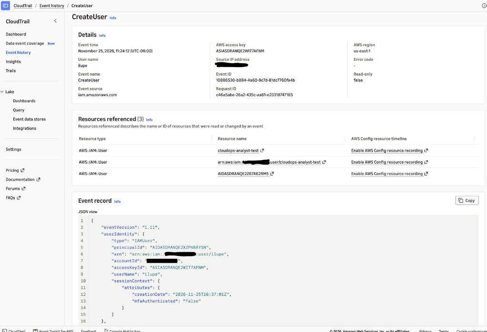
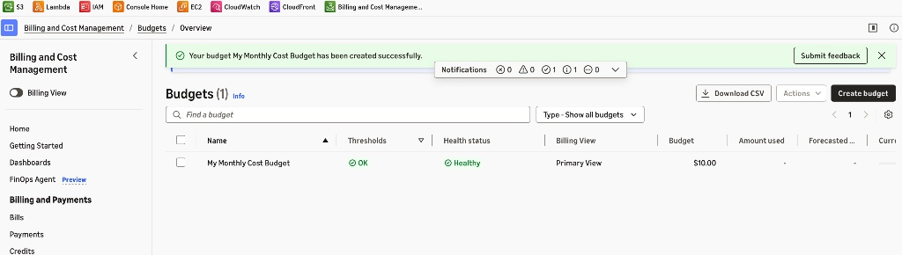

# User Access, Security Auditing & Cloud Budget Controls (AWS IAM, CloudTrail & AWS Budgets)

A cloud governance, security auditing, and FinOps project built on AWS using **IAM**, **IAM Access Analyzer**, **CloudTrail**, and **AWS Budgets**. Designed to enforce least-privilege access, continuously scan for unintended public exposure, maintain forensic API audit trails for incident response, and prevent unexpected cloud spending—all within the AWS Free Tier ($0).

## What Was Built & Verified
1. **Least-Privilege Access Control (`AWS IAM`):** Created a role-based group (`CloudOps-ReadOnly-Analysts`) with strictly scoped read-only policies (`AmazonEC2ReadOnlyAccess` and `AmazonS3ReadOnlyAccess`) and assigned a test user (`cloudops-analyst-test`) with console access disabled.
2. **Continuous Exposure Scanning (`IAM Access Analyzer`):** Deployed an external access analyzer (`Account-Security-Analyzer`) across the account and verified **0 active findings**, confirming no S3 buckets or IAM roles were accidentally exposed to the public.
3. **Forensic Audit Logging (`AWS CloudTrail`):** Enabled a management-event audit trail and investigated the `CreateUser` API event in `us-east-1` Event History, verifying capture of the UTC timestamp, IAM identity, source IP, target resource (`cloudops-analyst-test`), and raw JSON event record.
4. **Automated Cost Guardrails (`AWS Budgets`):** Configured a `$10.00` monthly cost budget (`My Monthly Cost Budget`) with automated email threshold alerts to prevent surprise bills.

## AWS Services Used
- **AWS IAM** (RBAC User Groups, Managed Policies, Least-Privilege Enforcement)
- **IAM Access Analyzer** (External Access & Public Exposure Scanning)
- **AWS CloudTrail** (Management Event Logging & Incident Forensics)
- **AWS Budgets** (Monthly Spend Guardrails & Alerting)

## Proof of Execution

### 1. Least-Privilege IAM User & Group

### 2. IAM Access Analyzer (0 Public Exposure Findings)

### 3. CloudTrail Forensic Audit Log (`CreateUser` Event)

### 4. AWS Budgets Spending Guardrail

